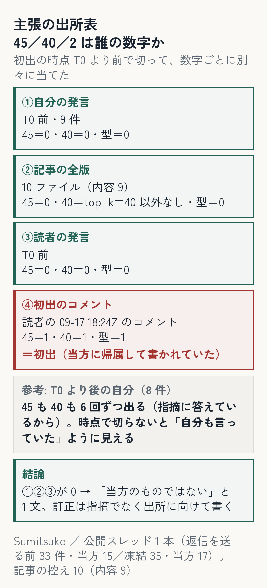

公開した記事に読者から指摘が続き、4 回訂正しました。5 回目に書きかけた訂正は、**存在しない誤りを認める文**でした。読者が当方の以前のコメントから取ったと書いた **45／40／2** を、その数字がスレッドに初めて現れた時刻（初出）より前に存在した自分の全発言と記事の全版に当てたら、「45」は 0 件、「40」は記事内の `top_k=40` 以外に該当なし、「45…40…2」の組は 0 件でした。凍結した範囲で確認できた初出は、読者自身の 2026-09-17 のコメントでした。

この記事は「読者が間違えた」話ではありません（同じスレッドで読者の指摘は 8 点全部当たっていました）。**訂正を書く前に何を引くか**の話です。



**この記事の位置づけ**（2026-09-26 追記）

- この記事で新しく示すこと: 読者が挙げた「あなたの数字」を、初出より前の自分の全発言と記事の全版に当てたら 0 件だった手順（出所表）。
- 当てはまる範囲: 当方の 1 スレッドです。

## 先に結論

- 訂正は「相手の指摘」に対してではなく、**「その主張の出所」に対して**書く。
- 引く順は 3 つ。①**相手の前の発言**（指摘は相手の前の発言から出ることがある）②**その数字の初出より前の自分の全発言**（後の発言は指摘への返答で同じ数字を含むので、時点で切らないと濁る）③**公開物の全版**（訂正の履歴＝before/after）。
- 3 つとも無ければ、**「その数字は当方のものではない」と 1 文で書く**。謝らず、責めず、それだけ。
- 合図は「訂正します」「言い過ぎでした」を書こうとした瞬間。

## 起きたこと

- 公開スレッド（当方の返信 2 件を送る前の時点で 33 件・当方 15 件。返信 2 件を送った後に凍結した木は 35 件・当方 17 件）。読者の再導出で当方の記事は 4 回訂正済み（数字の片側しか出していなかった等。読者の主張は 8 点とも当方の現物で真）。
- 読者のコメント（2026-09-18 11:01Z）に、自分の走査（catch 本体 47・ログあり 43・沈黙 2）を `against your 45 / 40 / 2` と比べる文がありました。続くコメント（19:13Z）で、読者はその 45／40／2 を当方の以前のコメントから取ったと書いています（逐語の引用ではなく要約です）。45／40／2 は、catch 本体 45・ログあり 40・沈黙 2 の組です。当方の手元の数え直しは 45／**41**／2。
- 当方の返信案（5 回目）は、こう書いていました: *"One correction on my side: 40 was not right either — 41 of the 45 try/catch bodies carry a log"*——**40 を言った覚えは無いのに、自分の訂正にしていた**。前日の精査（自分の返信を出す前に数字と言い方を現物で見る）が、この 1 文を「言っていない数字を言ったことにする＝5 回目の訂正を自作」として止めました。
- 出所を引いたら、45／40／2 は、読者自身の 2026-09-17 18:24Z のコメント（指摘のコメントの約 17 時間前）に **"which you now say in Limitations and I agree with: 45 TS catch bodies, 40 carry a log…"** と、当方に帰属する形で書かれていました。当方の Limitations にその数字はありません。

## T0 で切る（contamination barrier）

T0＝45／40／2 がスレッドに初めて現れた時刻（読者のコメントの投稿・2026-09-17 18:24:44Z）。読者が自分の走査と比べた指摘のコメントは、そのあと（09-18 11:01Z）です。**T0 より後の自分の発言は、その数字を含むやりとりの後なので汚染されていて証拠に使えません**（答えているのだから同じ数字を含む）。走査は数字ごとに別々に、**T0 より前**で切りました。「2」は単独では意味を持たない（どこにでもある）ので、型「45…40…2」で見ています。

| 数字 | ①自分の発言（T0 前・9 件） | ②記事の全版（10 ファイル・内容 9） | ③読者の発言（T0 前） | ④初出のコメント |
|---|---|---|---|---|
| 45 | 0 | 0 | 0 | 1 |
| 40 | 0 | `top_k=40` と `404` だけ | 0 | 1 |
| 45…40…2 の型 | 0 | 0 | 0 | 1 |

（参考: T0 より後の自分の発言 8 件には 45 も 40 も 6 回ずつ出ます——そのやりとりに答えているので当然で、**時点で切らなければ「自分も言っていた」ように見える**。これが T0 で切る理由です。）

③「公開物の全版」は dev.to の記事の控えです。読者が指していた Limitations／README は、返信を送る前の精査で別途 0 件を確認しました（README は、読者のコメントに出てくる公開リポの commit `e5b626a` で指します。README の本文は凍結しておらず、この記事の材料では再確認できません）。

走査の型（Python の正規表現）:

```python
NUM = lambda n: rf"(?<![\d.]){n}(?![\d.])"        # 45.0 や 140 を拾わない
TRIPLE = r"45[^0-9]{1,40}40[^0-9]{1,60}2\b"       # 45…40…2 の型
```

コメントは公開 API の木（`GET /api/comments?a_id=…`）を平らにし、`created_at < T0` と投稿者で分けました。記事の版は公開時に取っていた控え（before/after）です。

## 送った文

訂正の代わりに、事実だけを書きました（送った返信の一部です。2 文）。

> The sentence "45 TS catch bodies, 40 carry a log, and the only 2 silent ones are the demo block" first appears in your comment of Sept 17 (18:24 UTC), introduced with "which you now say in Limitations". I searched every comment of mine on this thread and every published revision of the article: the only 40 anywhere is top_k=40 in the setup.

この返信には、約 6 時間後の 2026-09-19 05:36Z に読者の返事が来ました。読者は、40 は自分の分類から来たもの（45 本体のうち 16＋15＋9＝40）で、誤った帰属は自分の側にあった、という趣旨を書いています。冒頭は `The 40 is mine, and now I can say where it came from` でした。数字そのものは、この返信より前（09-18 19:13Z）に読者の側でも「45／41／2 が files の支持する数」と揃っていました。ここで当方が 5 回目の訂正を書いていたら、**存在しない誤りが公開の記録に残っていた**——そこまでが観測で、その出所が読者の側だったことは、読者自身の返事でも裏づけられました。

## 持ち帰り: 主張の出所表（claim provenance）

訂正を書く前に、指摘された主張ごとに 4 列を埋めます。

| 列 | 何を引くか | 引き方 |
|---|---|---|
| ① 相手の前の発言 | 指摘は相手自身の前の発言から出ていないか | スレッドを T0 より前で読む |
| ② 自分の発言（T0 前） | 自分は本当にそう言ったか | 全件を機械で走査。**T0 より後は除く** |
| ③ 公開物の全版 | 記事のどの版にも無いか | before/after の控え。現在の版だけ見ない |
| ④ 初出のコメント | どの文で・どう帰属して書かれたか | 逐語で引用 |

①②③が 0 なら「当方のものではない」と 1 文。どれかが 1 以上なら、それが訂正の対象です。

## 言わないこと・測っていないこと

- 読者名・コメント ID は書きません。「読者が間違えた」を主題にしません——同じスレッドで読者の指摘は 8 点全部当たっていて、この 1 件も**帰属の取り違え**であって内容の誤りではありません。
- n=1 スレッド・1 件です。「訂正の N% は自作」のような率は出しません。発生率の記事ではなく、1 件から得た手順の記事です。
- AI レビュー・顧客の指摘・コードレビューにも同じ表が使えるはずですが、転用先では測っていません。

この記事の本家（凍結したコメント木の公開用の写し・走査の結果・検証の記録）は Sumitsuke Lab → [主張の出所表——訂正を書く前に引く 3 つと、5 回目の訂正を止めた精査の記録](https://sumitsuke.jp/via/zenn/lab/claim-provenance-before-correcting/)

### AI の利用について

返信案の起草・出所の走査・この記事の下書きには AI（Claude Code）を使っています。5 回目の訂正を止めたのは返信を出す前の精査（人が「精査して」と指示し、AI が現物で照合）で、送信と公開の判断は人が行いました。読者は本人の希望で「a reader」のままです。

### 関連

同じスレッドの「訂正した側」の記録（読者の再導出で成績表の片側が無かった）→ [公開した成績表は片側だった——読者が公開リポから数え直し、2 日で 3 回訂正し、公開 5 面のうち訂正対象 4 面の 2 面で止まっていた](https://sumitsuke.jp/via/zenn/lab/reader-rederived-report-card/)。出荷前に自分の盛りを引く話 → [出荷前に撤回した盛り 6 件（実績詳細）](https://sumitsuke.jp/works/cases/pre-ship-audit/)。本記事はその逆側＝引きすぎを止める話です。
