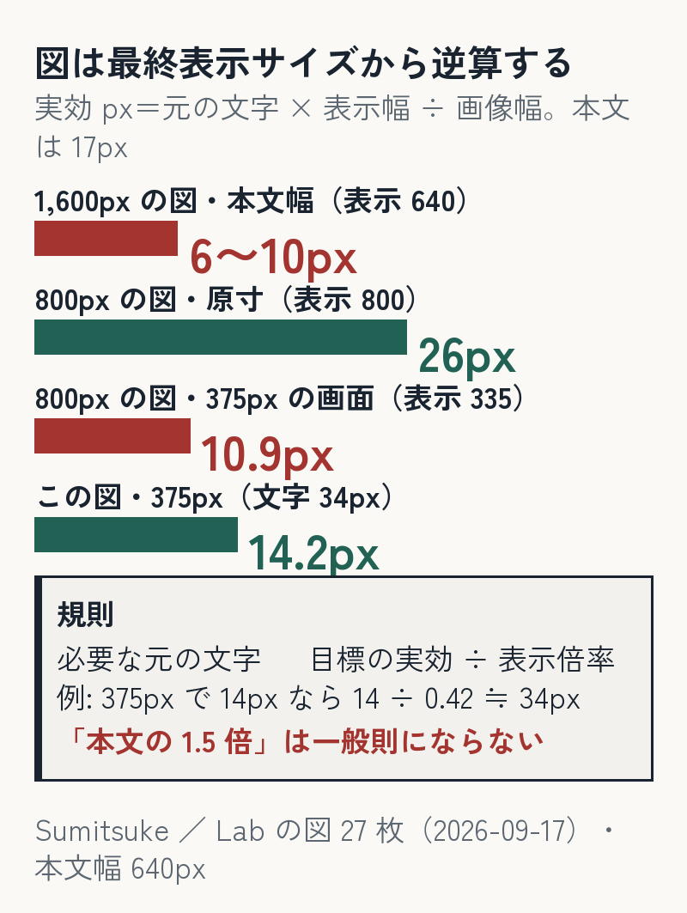

前回、Pillow で生成した図の「文字のはみ出し」を機械で数えて 0 にしました（[図の文字はみ出し検査](https://sumitsuke.jp/via/zenn/lab/figure-overflow-check/)）。同じ生成器の図 27 枚を本番の記事の中で測ったら、**27 枚のうち 17 枚は本文幅で文字が 10px 以下**でした。はみ出していなくても読めない。原因はキャンバスの大きさで作っていたことで、直し方は**最終表示サイズから逆算する**ことでした。



**この記事の位置づけ**（2026-09-26 追記）

- この記事で新しく示すこと: 図の実効の文字サイズ＝元の文字 px × 表示幅 ÷ 画像幅で、当方の 27 枚中 17 枚が本文で 10px 以下だった数と、逆算の規則。
- 当てはまる範囲: 当方のサイトの本文幅です。ほかのサイトでは本文幅に合わせて計算し直します。
- 時点: 本文の数と判断は 2026-09-17〜18 のものです。その後（09-25）の対応は、末尾近くの「その後の対応」に書きました。

## 測った結果（2026-09-17・本番）

| 群（枚数） | 画像幅・文字 | 本文幅 640px での倍率 → 実効の文字 |
|---|---|---|
| 第 1〜2 陣（**17**） | 1,600px・16〜24px（主に 18〜24） | 0.40 → **6〜10px** |
| 第 3 陣以降（10） | 1,200px・26〜32px | 0.53 → 14〜17px（1200px 未満の画面）／0.80 → 21〜26px（60rem 表示） |

（この表は 2026-09-17 時点です。601〜1,199px の窓では、のちに 1,200px 幅の図の文字が 10〜14px のままだと分かりました。下の「その後の対応」）

本文の文字は 17px。第 1〜2 陣の 17 枚は、はみ出し検査を通っていても本文の半分の大きさで、375px の画面ではさらに小さい。

（当初は「8〜10px 相当」と丸めていたが、16px × 0.40 = 6.4px なので下限は 6px。ここでは計算どおり 6〜10px と書く）

## 直したこと

**17 枚を作り直した**。新しい生成器の条件は 4 つ: 幅 800px・文字 26px 以上・横並びは縦積み・高さは描き終わりで切る。文言と数字は元の図の写しで、変えていない（`20a8864`）。

**CSS を 2 つ変えた**。図は原寸まで（拡大しない）。画面幅 1200px 以上では本文幅 40rem を越えて 60rem まで広げる。

```css
.prose img { width: auto; max-width: 100%; }   /* 原寸まで。拡大しない */
@media (min-width: 1200px) {
  .prose p:has(> img) { width: 60rem; margin-left: -10rem; }   /* 広い画面では本文幅 40rem を越えて 60rem まで（左右に 10rem はみ出す） */
}
```

直後の実測（JS・`getBoundingClientRect` と生成器の文字 px から換算）:

| 図 | 画面 | 表示幅 | 実効の文字 |
|---|---|---|---|
| 800px の図 | 1200px 以上 | 800（原寸） | 26px |
| 1,200px の図 | 1200px 以上 | 960 | 20.8px（本文 17px 以上） |
| 800px の図 | **375px** | **335** | **10.9px（この時点では未解決）** |

本番の 7 枚は Content-Length がローカルと一致・幅 800。

## 375px は（作り直した 17 枚では）解決していない（この時点では）

26 × 335 ÷ 800 ≒ 10.9px。本文の 1.5 倍（26px）で作っても、375px の画面では本文の 6 割にしかならない。作り直した 17 枚は「クリックで原寸」（拡大表示を提供する）で逃げているだけで、この時点ではこの制約が残っていた。ここは解決したと言わない（その後の対応は下に）。

この記事の図だけは、文字を **34px 以上**にして情報を削った（実効 34 × 335 ÷ 800 ≒ **14.2px**）＝下の選択肢 1。生成器に「335／640／800 での実効 px を印字し、375px で 14px を割る図は書き出さない」検査を入れ、この記事の図 5 枚が最初の対象。

## 持ち帰り: 計算表 4 項目と規則 1 つ

| 項目 | 例（375px） | 例（1200px 以上） |
|---|---|---|
| 画像幅 | 800 | 800 |
| 表示幅 | 335 | 800 |
| 元の文字 px | 26 | 26 |
| **実効の文字 px**＝元 × 表示幅 ÷ 画像幅 | **10.9** | **26** |

規則: **必要な元の文字 px ≥ 目標の実効 px ÷ 表示倍率**。375px で実効 14px を要るなら、倍率 335 ÷ 800 = 0.419 なので、元の文字は 14 ÷ 0.419 ≒ **34px 以上**。

「本文の 1.5 倍で作れば読める」のような固定倍率は一般則にならない。本件の 375px がその反例（26px は本文 17px の 1.5 倍だが実効 10.9px）。倍率は表示幅で決まるので、**先に表示幅を決めてから文字を決める**。

逆算して成立しない幅（375px で 34px 以上の文字は情報量が入らない）では、4 つのどれかを選ぶ:

1. 文字をさらに大きくして情報量を減らす
2. 横並びを縦積みにして画像幅を狭くする（倍率が上がる）
3. モバイル版を別に生成する（`<picture>` で出し分け）
4. 拡大表示を提供する（今回の選択・読める保証は無い）

## はみ出し検査と対で

前回の検査（描いた文字を全部記録して、枠外・安全余白・重なりを数える）は「枠に収まっているか」を見る。今回の計算表は「収まった文字が表示で何 px になるか」を見る。**測る量が違う**ので、片方が 0 でももう片方は残る。生成器に両方を入れて、書き出す前に数える。

公開中の図の現況（32 枚の内訳・未計測の 1 枚）と検証の記録は Lab 版に。

## その後の対応（2026-09-25）

- 「375px は未解決（クリックで原寸）」としていた分に、表示幅の下限を付けました。図ごとに最小の文字 px を一覧にし（33 枚）、画面が狭いときは図を段落の中で横に送って、実効 14px を割らない幅で表示します。本番の 15 頁 × 30 幅（280〜2,560px）で測ると、図の文字は 14px 以上（SVG は 15px 以上）でした。
- 最初は下限を 600px 以下の画面だけに効かせていたため、601〜1,199px の窓で 1,200px 幅の図（14 枚）の文字が 10〜14px のまま（601px で 10.2px）でした。条件を外して、全部の幅に効かせました。上の「第 3 陣の 10 枚は作り直していない」という判断は、この窓では当たっていませんでした。
- その代わり、601〜700px の窓（本文の列 526〜615px）では図が横に送られます。字を守る方を選びました（下限 647 → 631px＝字は 97.5%）。768〜1,180px では横スクロールは 0 です。

## 言わないこと

- 「1600px で作るな」とは言わない。表示倍率の話で、1600px の図でも文字が 45px なら 640 表示で 18px になる。
- 第 3 陣の 10 枚（1,200px・26〜32px）は 60rem 表示で本文級に読めると判断して作り直していない。これは判断で、測って 800px に統一したわけではない。
- SVG や写真は対象外。実スマホの実機では確認していません（375px 幅のブラウザでの計測だけです）。

この記事の本家（27 枚の内訳・判定・証拠）は Sumitsuke Lab → [はみ出し検査を通した図 27 枚を表示幅で測ったら、17 枚は本文の中で文字が 10px 以下だった——図は最終表示サイズから逆算して作る](https://sumitsuke.jp/via/zenn/lab/figure-legibility-at-display-width/)。

### AI の利用について

生成器と計測のスクリプトは AI（Claude Code）が書き、作り直す範囲の判断・375px を未解決とする判断・公開の判断は人が行いました。図は自分の記事のもの。

### 関連

前編＝[目視で「もう大丈夫」と言った図 8 枚に、描画ログのレイアウト検査を当てたら規則違反が 3 件残っていた——目視と機械は見るものが違う](https://sumitsuke.jp/via/zenn/lab/figure-overflow-check/)（枠の中に収まっているか）。本記事はその続き（収まった文字が読める大きさか）。

次に読む: [自作の検査器を数か月運用して数えたら、捕まえた欠陥 5 件に対して検査器を直した回数が 22 件だった](https://sumitsuke.jp/via/zenn/lab/green-is-not-proof/)
