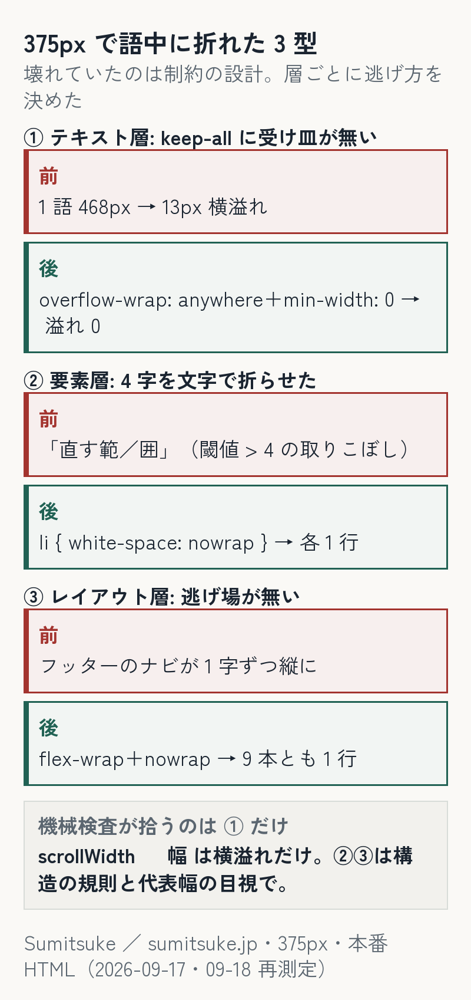

自社サイト（Astro・静的）を 375px で開くと、見出しが「直す範／囲」のように語の途中で折れ、フッターのナビが 1 字ずつ縦に潰れ、ある見出しは 1 語のまま列を押し広げて 13px 横に溢れていました。同じ日に 3 か所。原因はそれぞれ違い、**壊れていたのは 375px ではなく制約の設計**でした。breakpoint を足さず、3 層（テキスト／要素／レイアウト）で逃げ方を決めて直した記録です。

:::message
この記事の px の数字は 2026-09-17〜18 に測った当時の値で、測ったコマンドと出力は残していません。1 週間後の 09-25 に測り直すと、頁の作りが 3 か所とも変わっていて再現できませんでした（その記録は Lab 版に書きました）。CSS の直し方と、検査が何を見て何を見ないかは、数字と関係なく使えます。
:::



**この記事の位置づけ**（2026-09-26 追記）

- 既に知られていること: 日本語の語中の折れを抑える `word-break: keep-all`・`auto-phrase` は [MDN](https://developer.mozilla.org/en-US/docs/Web/CSS/word-break) にあります。
- この記事で新しく示すこと: 375px で同じ日に起きた 3 か所を、テキスト・要素・レイアウトの 3 層に分けて直した例。
- 当てはまる範囲: 当方のサイト 1 つ。px の数字は当時の値で、今は再現できません（本文の注意のとおり）。

## 3 型（当時の値・375px・本番 HTML を iframe に入れて計測）

| 層 | 症状（375px） | 原因 | 直し |
|---|---|---|---|
| テキスト | 読点の無い見出しが **1 語 468px**（`.final h2`）／**364px**（`.diag h2`）になり、列を押し広げて **13px 横溢れ** | `word-break: keep-all` が CJK の通常の改行を抑え、折り返す場所が無かった | `overflow-wrap: anywhere` を対で置く＋列に `min-width: 0` |
| 要素 | 4 字の項目「直す範囲」「次の費用」が「直す範／囲」と文字単位で折れる（1280px の Hero 右でも） | 4 列固定の grid に 4 字×4 項目が 22rem に入らない。長さで分岐する閾値 `> 4` が「ちょうど 4 字」を取りこぼしていた | `li { white-space: nowrap }`＝語の途中では折らない |
| レイアウト | フッターのナビが **1 字ずつ縦に潰れる**（公開時からの欠陥・別の直しの目視で発見） | 逃げ場が無い（wrap なし） | `flex-wrap: wrap`＋`a { white-space: nowrap }`＝入らなければ項目ごと次の行 |

### テキスト層: keep-all は受け皿と対で

日本語の見出しに `word-break: keep-all` を当てると、読点や空白の無い文は 1 語として扱われる。「直す前に、何が壊れているかを確定する。」は読点で折れるが、読点の無い既定の見出しは折れず、**そのまま 468px の 1 語**になって親の列を広げた（列が中身に合わせて広がっていた。列に `min-width: 0` を当てると止まった＝観測）。

```css
.final h2, .diag h2 { word-break: keep-all; overflow-wrap: anywhere; }  /* 通常は語で折り、入らないときだけ非常用に折る */
.diag > div { min-width: 0; }  /* 列が中身に合わせて広がらないように */
```

`overflow-wrap: anywhere` は「通常の折り返し位置が無いときにだけ」任意の位置で折る。keep-all の読みやすさを残したまま溢れの受け皿になる。直後の実測（当時）: 2 つの h2 とも 335px（内容幅）・横溢れ 0。

### 要素層: 閾値をやめる

「届くもの」4 項目（再現／原因／直す範囲／次の費用）は、長い項目があるときだけ縦 1 列に切り替える `items.some(s => s.length > 4)` で分岐していた。「直す範囲」「次の費用」は**ちょうど 4 字**で条件に入らず、4 列のまま Hero 右の 22rem に押し込まれて文字単位で折れた（1280px で「直す範／囲」）。

閾値を `>= 4` に直すのが最短だが、それでは次に 5 字の項目が来たときにまた境界を踏む。**閾値を要らなくする**方を選んだ。

```css
.deliver { display: flex; flex-wrap: wrap; }   /* 4 列固定をやめる */
.deliver li { white-space: nowrap; }          /* 項目は語の途中で折らない。入らなければ項目ごと次の行 */
```

実測（当時・1280px・repair）: 4 項目とも 1 行（幅 44／44／88／88px）で 2 段に並ぶ。トップは 1 段。375px でも `white-space: nowrap`・44／44／88／88。

### レイアウト層: 逃げ場を作る

フッターのナビは `display: flex` に `flex-wrap` が無く、375px では各リンクが縮められて 1 字ずつ縦に並んでいた。公開時からそうなっていて、テキスト層の直しを 375 で目視したときに見つけた（機械検査は横溢れしか見ていないので、幅に収まっているこの潰れは拾えない）。

```css
.site-footer nav { display: flex; flex-wrap: wrap; gap: 0 1.5rem; }
.site-footer nav a { white-space: nowrap; }
```

実測（当時・375px・2026-09-18）: ナビ 9 本の高さがすべて 48px＝各 1 行。

## 検査の役割分担（ここが本題）

直した後に `scrollWidth ≤ 幅` を 375px で全ページに当てて 0 としました（当時の記録は残っていません。手元に残っているのは、09-25 に測り直した頁の `scrollWidth` 375 ＝ 幅 375 だけです）。ただしこの検査は**横溢れ（テキスト層）だけ**を見る。語中折れ（要素層）と縦潰れ（レイアウト層）は、幅に収まったまま起きるので `scrollWidth` では出ない。

| 検査 | 拾える | 拾えない |
|---|---|---|
| `scrollWidth ≤ 幅`（機械） | 横溢れ | 語中折れ・縦潰れ |
| 構造の規則（`nowrap`＋`wrap`） | 語中折れ・縦潰れを起こさない | — |
| 代表幅（375／800／1280／1440）の目視、または要素の行数・高さの検査 | 語中折れ・縦潰れ | 数 px の溢れ |

「3 型を全部機械で検査できる」わけではない。機械に渡せるのは横溢れと、要素単位なら「行数（高さ ÷ 行高）が 1 か」くらい。残りは構造で起きなくして、代表幅で見る。

## 持ち帰り

1. `word-break: keep-all` を使うなら `overflow-wrap: anywhere` と `min-width: 0` を**対で**置く（受け皿の無い keep-all は溢れる）
2. 長さで分岐する閾値は「ちょうど」を境界に入れる——より良いのは**閾値を要らなくする構造**（項目は nowrap・容器は wrap）
3. 375px で全頁の `scrollWidth ≤ 幅` を機械で数える。ただしそれは横溢れだけ。語中折れと縦潰れは構造の規則と代表幅の目視で見る

## 言わないこと

- 「keep-all を使うな」とは言わない。読みやすさのために使い、溢れの受け皿を対で置く。
- ブラウザは Chromium 系 1 種で測った。他ブラウザと実機（スマホ本体）は確認していません。
- デザインの良し悪しは扱わない。ここで数えたのは「折れているか・溢れているか」だけ。

当時の数字を 1 週間後に再現できなかった記録（何を残せばよかったか）は Sumitsuke Lab → [375px の見出しの崩れを直した 1 週間後、その数字を再現できなかった](https://sumitsuke.jp/via/zenn/lab/ja-heading-midword-wrap-three/)。

## 追記（2026-09-26）

- 語中の折れとは別の型、見出しの最後の行が 1〜2 字だけになる崩れも数えました（サイト全体 78 頁・09-25）。1,280px（スクロールバーあり）で 7 件、375px で 25 件。見出しに `text-wrap: balance` と `word-break: auto-phrase` を当てて、どちらも 0 になりました。
- `auto-phrase` に対応しているのは Chrome・Edge だけで、Safari は今のままです。Safari の数は測っていません。

### AI の利用について

CSS の直しと計測のスクリプトは AI（Claude Code）が書き、症状の指摘・採否・公開の判断は人が行いました。対象は自社サイトで、顧客案件は含みません。

### 関連

図（PNG）の中の文字がはみ出す方は [目視で「もう大丈夫」と言った図 8 枚に、描画ログのレイアウト検査を当てたら規則違反が 3 件残っていた——目視と機械は見るものが違う](https://sumitsuke.jp/via/zenn/lab/figure-overflow-check/)。本記事は CSS の折り返しで、測る量が違う。

次に読む: [はみ出し検査を通した図 27 枚を表示幅で測ったら、17 枚は本文の中で文字が 10px 以下だった——図は最終表示サイズから逆算して作る](https://sumitsuke.jp/via/zenn/lab/figure-legibility-at-display-width/)
