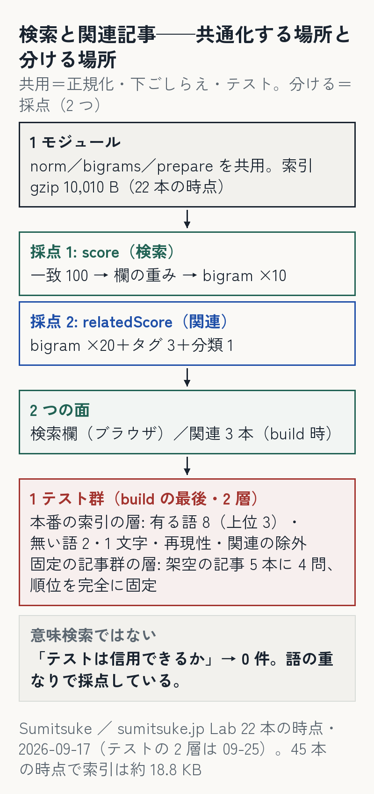

自社サイトの検証記事（22 本）に検索欄を付け、同時に各記事の末尾の「関連する検証」を build 時に自動で選ぶようにしました。既製の検索ライブラリは入れず、先に**共通化する場所**（正規化・下ごしらえ・テスト）と**分ける場所**（採点）を決めました。形は **1 つのモジュール**（正規化と下ごしらえを共用）・**2 つの採点関数**（検索用・関連用）・**2 つの面**（ブラウザの検索欄・build 時の関連）・**1 つのテスト群**（build の最後に走る、わざと壊した入力での試験。2026-09-25 に 2 層に分けた＝後述）です。索引は gzip で 10,010 B、検索の script は 1,141 B。

「1 つの採点器で検索も関連も」と書きたくなりましたが、現物を読み直すと採点関数は 2 つでした。共用しているのは正規化・バイグラム・テストです。ここは正確に書きます。



**この記事の位置づけ**（2026-09-26 追記）

- この記事で新しく示すこと: 検索と関連記事で、正規化・下ごしらえ・テストを共用し、採点だけを分けた形とそのサイズ。
- 当てはまる範囲: 記事 22 本の時点の値です（45 本の時点で索引は約 18.8 KB）。テストは 2026-09-25 に 2 層に分けたので、テストの節は 25 日以降の形で書いています。

## 構成

```
src/lib/labsearch.mjs      … norm / bigrams / prepare（共用）・score（検索）・relatedScore（関連）
/lab/search.json           … 索引 22 件（メタ＋結論 1 行目・本文全文なし）
src/pages/lab/index.astro  … 検索欄（ブラウザで search を呼ぶ）
src/pages/lab/[slug].astro … 記事末尾の関連（build 時に related を呼ぶ）
scripts/check-search.mjs   … わざと壊した入力を含むテスト（build の最後。実行時間は測っていない）
```

### 共用する部分: 正規化と下ごしらえ

```js
export function norm(s) {
  return String(s ?? '').normalize('NFKC').toLowerCase()
    .replace(/[／]/g, '/').replace(/[：]/g, ':').replace(/[・]/g, ' ')
    .replace(/\s*([\/:])\s*/g, '$1')                       // 「14 / 14」と「14/14」を同じに
    .replace(/[「」『』（）()【】\[\]、。，．,.！!？?―—…]/g, ' ')
    .replace(/\s+/g, ' ').trim();
}
export function bigrams(s) { /* 空白を除いた 2 文字の集合 */ }
export function prepare(doc) { /* 欄ごとの正規化文字列 f と、題・問い・タグ・別名・keyShort のバイグラム集合 bg */ }
```

NFKC で全角英数を半角に（「ＪＳＯＮＬ」→「jsonl」）、「/」「:」の前後の空白を落とす（「14 / 14」と「14/14」が同じ文字列になる）。

### 採点 1: 検索 `score`（3 段）

| 段 | 条件 | 点 |
|---|---|---|
| ① 完全・部分一致 | 題・問い・タグ・別名のどれかに検索文字列そのものが含まれる | 100（1 回だけ） |
| ② 語ごとの一致 | 語ごとに欄の重み（問い 4・題 4・タグ 3・別名 3・keyShort 2・分類 1.5・説明 1・結論 1）× 語の長さの係数（1〜3） | 欄ごと加算 |
| ③ バイグラムの類似 | 検索文字列と記事のバイグラム集合の dice 係数（2 つの集合の重なりの割合＝2 × 共通 ÷ 合計）× 10（**1 文字の検索では使わない**） | 0〜10 |

2 点未満は「一致」と呼べない（バイグラムの残りかす）ので出さない。上位 5 件。

実測: 「検査器 直す回数」→ green-is-not-proof 36.8・plugin-cost-benefit 16.9・guard-message-drift 13.3。「Claude Code」→ 3 本が 130 点超（① の 100 が効く）。**「テストは信用できるか」→ 0 件**。語の重なりで採点しているので、意味が近くても語が違えば出ない。これは欠陥ではなく、この検索が「意味検索ではない」ことの実例。

### 採点 2: 関連 `relatedScore`

```js
// 簡略にした抜粋: 実物には tagsAndAliases という関数は無く、タグと別名を集合にして同じ判定を書き下している
export function relatedScore(a, b) {
  let s = 20 * dice(a.bg, b.bg);                       // 題・問い・タグ・別名・keyShort のバイグラムの重なり
  for (const t of tagsAndAliases(a)) if (t.length >= 2 && tagsAndAliases(b).has(t)) s += 3;   // タグ／別名の一致
  if (a.f.category && a.f.category === b.f.category) s += 1;   // 同じ分類は弱い加点だけ
  return s;
}
```

6 点未満は出さない（関連が無いなら出さない）・自分は出さない・最大 3 本。手で書いた関連（`relatedLab`）があればそれを優先し、自動の分は重複を除いて足す。

## 1 つのテスト群（build の最後・2 層）

2026-09-25 に 2 層に分けました。**記事が増えると動く答え**（本番の索引に当てる）と、**採点が壊れたら動く答え**（固定の小さな記事群に当てる）を別に持つ形です。まず本番の索引に当てる層です。

```js
const CASES = [
  ['検査器 直す回数', 'green-is-not-proof'], ['LLM 見直し', 'llm-self-review-ceiling'],
  ['JSONL 改行', 'jsonl-line-separators-three'], ['14/14', 'rich-editor-three-rules'], ['14 / 14', 'rich-editor-three-rules'],
  ['図', ['figure-overflow-check', 'figure-legibility-at-display-width']], ['テスト件数', 'test-count-three-ways'], ['ＪＳＯＮＬ', 'jsonl-line-separators-three'],
];
```

| 検査 | 内容 |
|---|---|
| 有る語 8 | 上の 8 語で、期待の記事が上位 3 に入るか（「14/14」と「14 / 14」・全角「ＪＳＯＮＬ」を含む。「図」は 2 本のどちらでも可） |
| 無い語 2 | 「ぬるぽがっ」「zzzz9999」→ 0 件 |
| 閾値 | 「テストは信用できるか」→ 2 点未満を出していないか |
| 1 文字 | 「図」で substring の無い記事が 0 点か（バイグラムを使っていない） |
| 再現性 | 同じ語で 2 回引いて順位が同じか |
| 関連 | 自分を出さない・6 点未満を出さない・4 本以上出さない |
| 生成物 | 22 頁すべてに関連が入っているか・索引の gzip が 100 KB 未満か |

結果（2026-09-18 に再実行・22 本・テストが 1 層だった時点）: `検索: 記事 22・索引 gzip 10,010 B・script gzip 1,141 B（1 本）・関連あり 22/22 頁・検索語 8＋無語 2` → 赤なし。45 本になった 2026-09-25 の build でも、2 層にした後のテストは「検索語 8＋無語 2」「関連あり 45/45」で赤なしでした（索引は gzip 18,794 B）。

期待を 1 つ差し替えて赤になることを確認してから信じた（2 層にした後の形では、差し替えると `検索「…」: 上位 3 に期待の記事が無い（期待 …）。上位=…` で exit 1）。

### 期待値が、記事の増えた日に外れた

「図」は 1 文字の検索で、当初は図の記事（はみ出し検査）が 1 位でした。09-18 に図の記事が 2 本になって 1 位が入れ替わり、テストが赤になりました（その日のコミットに「新記事で 1 位が入れ替わった」と残っています）。検索の欠陥ではなく、期待を 1 本に固定したテストの側の問題だったので、期待を「2 本のどちらか」に緩めました。09-25 の時点で 1 位と 2 位の点は 116 と 115 の 1 点差です。

緩めるだけだと、今度は採点が壊れても気づけません。そこで 09-25 に層を分けました。

- **本番の索引の層**（上の表）: 有る語 8 は「期待の記事が上位 3 に入るか」に。記事が増えて順位が入れ替わっても赤にならず、期待の記事が上位から消えたときに赤になります。
- **固定の記事群の層**: 題だけ・説明だけ・問いとタグ、のように欄を変えて置いた架空の記事 5 本に 4 問を当て、順位を完全に固定します。期待は、欄の重み・完全一致の 100 点・閾値 2 点から**手で数えた**もので、実装を走らせて写したものではありません（「置き場」→ a の 110 点だけ・b は 1.5 点で出ない／「名義」→ c 109.2・e 106.5）。

この固定の記事群にも、採点の壊れ方を 3 通り入れて確かめました。問いの重み 4→1 と閾値 2→1 は赤になりました（順位が入れ替わる・弱い一致が出る）。題の重み 4→5 は緑のままでした（点は動くが順位は入れ替わらない）。固定の記事群が捕まえるのは、順位が変わる壊れ方だけです。

⚠ gzip の値は測り方で変わる。`gzip -c | wc -c` では 9,864 B、テストが使う Node の `zlib.gzipSync` では 10,010 B。**記事の値は build 直後にテストが印字した 10,010 B**に統一した。

## Pagefind を採用しなかった理由（1 段落）

比較実験はしていない。採用しなかったのは、順位を自分の欄の重みで決めたかったこと・関連記事の算出と正規化を共用したかったこと・UI を自分の索引頁に合わせたかったこと、の 3 つ。外部レビューに「Pagefind は日本語を 1 字分割する」という指摘があったが、公式の説明では、日本語を含む言語の単語分割は extended 版にあり、`npx pagefind` の既定は extended 版なので、その指摘は当てはまらない。当方は動かして確かめてはいない。この指摘を採用しなかった理由に使わないよう、比較の理由を上の 3 つに直した。

## 共通化する場所と分ける場所

- 共通化した: 正規化（`norm`）・バイグラム（`bigrams`）・下ごしらえ（`prepare`）・テスト群。ここが二重になると「検索では出るのに関連には出ない」型のずれが起きる。
- 分けた: 採点。検索は「検索文字列そのものの一致」を 100 点で最優先にしたいが、関連は「題や問いの言い回しの近さ」を見たい。目的が違うので採点を共用すると片方が歪む。
- 分けたまま守る: 同じ入力（`prepare` の出力）に対して 2 つの採点を当て、テストは 1 つの群で両方を見る。

## 適用範囲

- 22 本・日本語主体・索引は本文全文なし。50 本を超えたら再評価する（性能の限界が 50 本という意味ではなく、運用上の再訪条件。それまで追加のベンチはしない）。
- 英語混在・本文検索・同義語は測っていない。
- 「22 本に検索が要るか」は本記事の主張ではない（要らないかもしれない）。主張は「検索と関連を 1 モジュール・1 テスト群で持てた」まで。

## 言わないこと

- 「Pagefind より良い」とは言わない（比較していない）。
- 「1 つの採点器で検索と関連を共用」とは言わない（採点は 2 つ）。
- 「意味検索」とは呼ばない（語の重なり）。

この記事は Zenn 版だけです。「期待を差し替えて赤を確かめてから信じる」型の検証記録は Sumitsuke Lab → [自作の検査器を数か月運用して数えたら、捕まえた欠陥 5 件に対して検査器を直した回数が 22 件だった](https://sumitsuke.jp/via/zenn/lab/green-is-not-proof/)。

### AI の利用について

モジュールとテストのコードは AI（Claude Code）が書き、採点の重み・検索語の選定・公開の判断は人が行いました。対象は自社サイトで、顧客案件は含みません。

### 関連

検索欄と関連が動いている記事の例＝[自作の検査器を数か月運用して数えたら、捕まえた欠陥 5 件に対して検査器を直した回数が 22 件だった](https://sumitsuke.jp/via/zenn/lab/green-is-not-proof/)（末尾の「関連する検証」が build 時の算出）。

次に読む: [正常なのに赤が 2 回——期待値を別言語で数えたら、被検査物ではなく自分の丸めと語彙の癖が捕まった](https://sumitsuke.jp/via/zenn/lab/oracle-independence-caught-my-habits/)
