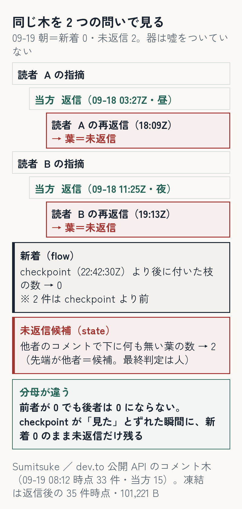

コメントの反応を毎朝 API で数えるスクリプトを回しています。そのスクリプトが「新着 0」と印字した朝に、返していないコメントが 2 件残っていました。スクリプトは嘘をついていません。**「新着」と「未返信」は分母が違う**——それだけの話ですが、当方は 2 日おきに 2 回、別の形で取りこぼしました。



**この記事の位置づけ**（2026-09-26 追記）

- この記事で新しく示すこと: 「新着」（差分）と「未返信」（現在の状態）は分母が違い、新着 0 でも未返信が残る実例 2 回。
- 当てはまる範囲: 当方の記事のコメントの点検です。

## 先に結論

- **新着**＝前回見た時刻（checkpoint）より後に付いたコメントの数。**差分（flow）**。
- **未返信（候補）**＝他者のコメントのうち、その下に誰の返信も付いていないもの（木の**葉**）の数。**現在状態（state）**。厳密には「会話木の先端が他者」＝**未返信候補**で、第三者どうしの会話も含みうる（後述）。
- 分母が違うので、新着 0 でも未返信は 0 になりません。checkpoint が「自分が本当に見た時刻」とずれた瞬間に、新着は 0 のまま未返信だけが残ります。
- 当方で起きた 2 つは型が違いました。**事故 A**（09-17）: 返信を欄に入れた後、送信を確かめずに「未返信 0」と書いた（送られていなかった）。**事故 B**（09-19）: スクリプトが「新着 0」と印字した朝に葉が 2 件（checkpoint が前回の「見た」を表していなかった）。
- 直しは 4 層。①新着＝差分 ②未返信＝現在状態を全走査（葉を数える） ③checkpoint は面・記事ごとに分け、「見た」実行だけが進める ④返信後＝API を再取得して自分の返信が木に在ることを確かめる。

## 起きたこと

### 事故 A（09-17）: 返信したつもり

- 20:2x 反応を数えた: 新着 0・未返信 0 と記帳。
- 20:3x スレッド単位で数え直した: **1 件残っていた**。理由は、返信欄に入れた文面が**送信されていなかった**（入力まではしたが Submit していなかった）。
- 型: 新着／未返信の分母の話ではなく、**操作の完了を再確認していない**問題。直しは④（返信後に API を再取得して自分の返信が木に在るか見る）。

### 事故 B（09-19）: 新着 0・未返信 2

- 08:12 のスクリプトの印字（原文）: `他者コメント 18（新規 0）⚠ 未返信`・`前回以降＝ 2026-09-18T22:42:30Z`。
- スクリプトは「⚠ 未返信」の札は出していました。無かったのは**件数と ID**（当時のスクリプトは 1 語だけ）。2 件（18:09Z と 19:13Z の他者コメント）を特定したのは、メール通知から API を自前で走査した後でした。
- checkpoint が 22:42:30Z を持っていた＝その時刻に何かが「見た」ことになっていました。何がそれを書いたかは記録に残っていません。同じ時間帯に試走の記録はありますが、それは別のスクリプト（Qiita の間隔投稿）の 6 分後の記録で、checkpoint を書くスクリプトと同じかは確認できていません。**原因は名指ししません**。
- 型: checkpoint が「自分が見た」を表していない。直しは③（checkpoint を面・記事ごとに分け、「見た」と書いた実行だけが進める）と②（現在状態を毎回全走査する）。

## 葉で数える（直し②・9 行）＝未返信候補

dev.to の公開 API（`GET /api/comments?a_id=…`）は、当方が 2026-09-19 に取った応答ではコメントが入れ子の木になっていました（この構造は、公式の API 文書に記載を見つけていません）。「他者のコメントで、子が 1 つも無いもの」を数えるだけです。

```python
ME = {"tauridev"}
def leaves_by_others(tops, who, kids=lambda c: c.get("children") or []):
    """他者のコメントで子が 1 つも無いもの＝会話がその人で終わっている＝未返信。"""
    out = []
    def walk(c):
        ch = kids(c)
        if not ch and who(c) not in ME: out.append(c)
        for k in ch: walk(k)
    for t in tops: walk(t)
    return out
```

- わざと壊した入力: 当方の返信を木から外して走らせると、09-19 朝の 2 件がそのまま出る。今の木では 0。
- 定義: この関数が数えているのは**「会話木の先端が他者」**です。第三者どうしで閉じた会話の先端も拾うので、名前は `unreplied_candidates`（未返信候補）が正確で、最終判定は人が読みます。当方の 1 記事（08:12 時点 33 件・返信後の凍結では 35 件）では第三者どうしの先端は 0 でした。
- 平らな API（Qiita）では「他者の最後のコメントより後に当方のコメントがあるか」で代替しています。
- Zenn は、当方が試した取得経路（`/api/comments?article_id=`）が 2026-09-19 時点で 404 だった（再確認はしていません）ので、記事 API の `comments_count` の前回差で「＋N（本文は画面で読む）」だけ出しています。「Zenn にコメント API が無い」とは言いません。

## flow × state の 2×2

| flow（新着） | state（未返信候補） | 意味 |
|---|---|---|
| 0 | 0 | 新しいものも残件もない |
| >0 | 0 | 新着はあったが、いまは処理済み |
| **0** | **>0** | **今回の型。新着なしだが残件あり** |
| >0 | >0 | 新着かつ残件あり |

新着だけ見ていると 3 行目が「0 行目」に見えます。

## 4 層（直し）

| 層 | 何を | 答える問い |
|---|---|---|
| ① 新着 | checkpoint より後のコメントを列挙 | 前回から何が増えたか（flow） |
| ② 未返信 | 木を全走査して他者の葉を数える・ID と本文を印字 | 今、返していないものは何か（state） |
| ③ checkpoint | 面・記事ごとに持ち、「見た」と記帳した実行だけが進める | 前回の「見た」はいつか |
| ④ 送信の確認 | 返信後に API を再取得し、自分の返信が親の直下に在ることを見る | 返したつもりは返せているか |

もう 1 行: **未返信 0 の日にも「見た本数」を印字する**（`dev.to 6 本・他者コメント 19 件`）。0 件で緑になるスクリプトは、見たのか空なのかが読めません。

## 一般形（測っていない範囲）

「新着」は**イベント指標**、「未返信」は**状態指標**です。混ぜると、イベントが 0 の日に状態が残ります。メール・Issue・障害キューにも同じ形が現れるはずですが、当方が測ったのはコメント 1 記事・2 回だけです。**計測設計上の性質**として書いていて、「一般に事故が起きる」とは言いません。

この記事の本家（2 回の事故の記録・凍結したコメント木の公開用の写し・checkpoint の値・検証の記録）は Sumitsuke Lab → [イベント指標と状態指標を混ぜない——「新着 0」の朝に未返信が 2 件残っていた記録と、葉で数える 9 行](https://sumitsuke.jp/via/zenn/lab/flow-vs-state-unreplied/)

### AI の利用について

反応を数えるスクリプトの実装と、この記事の下書きには AI（Claude Code）を使っています。数字（1 件・2 件・18・19・33）は API の応答と運用記録から写し、判断と公開は人が行いました。読者名・コメント ID は書いていません。

### 関連

検査が空振りして緑になる話（0 件で緑）は → [自作の検査器を数か月運用して数えたら、捕まえた欠陥 5 件に対して検査器を直した回数が 22 件だった](https://sumitsuke.jp/via/zenn/lab/green-is-not-proof/)。本記事は、スクリプトが正しく 0 を出しているのに問いが違う話です。
