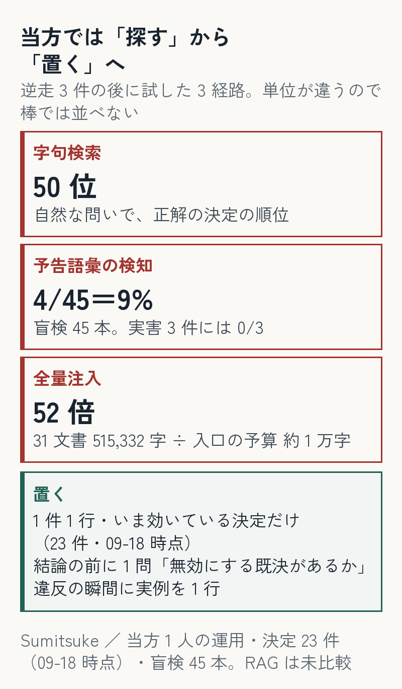

AI（Claude Code）に作業を任せていると、**過去に決めたこと（既決）に反する提案**が出てきます。当方では、既決を見落として逆走した実害が **3 件**ありました。「決定を検索させれば防げる」と思って 3 つの経路を試し、3 つとも実用になりませんでした。いま動いているのは、**いま効いている既決だけ（2026-09-18 時点で 23 件・1 件 1 行。10-01 現在は 24 件）を入口の文書に置き、結論を書く直前に 1 問だけ問う**形です。3 つの経路の数字は 2026-07-31 の実験記録です。

**この記事の位置づけ**（2026-09-26 追記）

- この記事で新しく示すこと: 既決を探させる 3 経路の数字（正解が 50 位・予告語彙 9%・予算の 52 倍）と、いま効いている既決だけを置く形。
- 当てはまる範囲: 当方の運用（既決 23 件は 2026-09-18 時点の件数で、10-01 現在は 24 件）。逆走は低頻度なので、効果の証明ではありません。

## 試して実用にならなかった 3 経路

| 経路 | 何をしたか | 結果 |
|---|---|---|
| 字句検索 | 決定文書を AI に検索させる | 自然な問いで、正解の決定が **50 位** |
| 違反を予告する語彙で検知 | 「この語が出たら違反の可能性」を事前に用意し、盲検で当てる | **4/45（9%）**。実害 3 件には **0/3** |
| 全部注入 | 決定文書を毎回すべて読み込ませる | 31 文書 **515,332 字**＝入口に常時注入できる予算（約 10,000 字）の **52 倍** |

⚠ 「上限の 52 倍」の上限は、**当方が入口の文書に常時注入すると決めている予算（約 10,000 字）**で、モデルの文脈上限ではありません。⚠ RAG や埋め込み検索は比較していません。だから「検索では防げない」とは言いません。言えるのは「字句検索・事前の語彙・全量注入は当方では実用にならなかった」までです。

死んだ理由は、当方は 2 系統だと読んでいます。**字句検索と予告語彙には共通の弱点**があり、決定文に書いてある語が違反の文に出るとは限らない（9%）。違反の枠は決定の側でなく、違反する側の状況から来る、と読んでいます。だから事前に語彙を想像しても当たらなかった、と考えています。**全量注入は別の理由**で、単純に入口の予算を 52 倍超えた。

## 全部を探させず、いまの既決だけを置く

やめたのは「探す」。代わりに、入口の文書に**決定文だけの一覧**を常時置きました。

- 1 件 1 行。いま効いている決定だけ（23 件）。却下した案・数値の読み方・覆す条件は**別の正本へ逃がす**（一覧に混ぜると読む量が増えて読まれない）。
- 結論を書く直前に 1 問: **「この結論を無効にする既決があるか」**。思い当たったら正本を引く。思い当たらなければそのまま進む。
- 違反や訂正が起きた瞬間に、その実例を 1 行足す。事前の想像で語彙を作らない（9% の教訓）。

効いた 1 例（2026-09-18）。記事の解析で「CTA を直せば到達率が上がるのでは」を改良候補に挙げ、1 問を当てたら「30 日実測の定義は 10-17 まで凍結」という既決に当たり、「触らない」と裁定しました。その既決は、10-01 現在の入口の 24 件には見当たりません（理由は確認していません）。

## 台帳の最小形式

23 件（09-18 時点）を文章の一覧にせず、4 列の最小台帳にすると寿命が伸びます（当方の台帳は `id・scope・file・line・body` の 5 列で、失効はまだ本文の文「前の裁定 X はこれで失効」で追っている＝4 列目は次に足す改良）。

| 列 | 中身 | なぜ |
|---|---|---|
| `ID` | `d-20260918-zenn-title-70` のような固定 ID（日付＋短い語） | 引用できる |
| いまの決定 1 行 | 例:「Zenn の記事の title は 70 字以内（下書きでも超えるとリポジトリ全体のデプロイが止まる）」（70 字は当方の観測で、Zenn の公式文書には記述を見つけていません） | 一覧に出すのはこれだけ |
| 適用範囲 | 例: 記事の公開 | 無関係な場面で発火させない |
| `superseded-by` | 失効したら後継の ID | **古い既決を消さずに失効を記す**（消すと「決まっていない」に見える。残すと逆に古い既決で事故る。両方を防ぐ） |

当方は 23 件（09-18 時点。10-01 現在は 24 件）を入口に置き、詳細は正本に逃がしています。件数が増えて**入口の一覧を毎回目視できなくなったとき**が再訪条件で、そのときに索引・検索・RAG を比較します。今は決めません。

## 言わないこと

- 「検索は無駄」とは言わない。試したのは字句検索・語彙検知・全量注入の 3 経路で、RAG・埋め込みは未比較。
- 23 件の中身（事業の裁定）は書かない。件数と形式だけ（例に挙げた 1 行は記事の運用の決定で、事業の裁定ではない）。
- 「上限」は入口の注入予算（約 10,000 字）。モデルの文脈上限ではない。
- n=1 の運用（決定 23 件は 09-18 時点・盲検 45 本）の記録で、一般法則ではない。

この記事の本家（3 経路の数字・台帳の形式・検証の記録）は Sumitsuke Lab → [いま効いている既決だけを入口に置く——字句検索 50 位・予告語彙 9%・全量注入 52 倍の後に「探さない、置く」](https://sumitsuke.jp/via/zenn/lab/active-decision-register/)。

### AI の利用について

3 経路の実験は AI（Claude Code）と人で行い、盲検の判定・「探さない」への裁定・公開の判断は人が行いました。

### 関連

この記事は、結論を書く前に既決を確かめる仕組みの話でした（当方は、条件を満たさないと進めないよう止めるチェックを「門」と呼んでいます）。前は、規律をどこに置くかの話 → [規律の置き場所——同じ規律を 5 つの置き場所に書いて効いたのは記憶の 1 行、公開直前のスクリプトに置いたチェックは初回で 2 本拾った](https://sumitsuke.jp/via/zenn/lab/rule-placement-document-vs-gate/)。最初に戻る → [Windows で AI にファイルを書き換えさせたら触っていない行が変わった——5 つの型を 5 行のファイルで再現した](https://sumitsuke.jp/via/zenn/lab/file-edit-five-traps-windows/)。

次に読む: [同じ AI レビューを 1 日に 7 回かけたら、同じ誤りが 4 回続いた——回答の数は証拠の量ではない。判断は「新しい証拠」で](https://sumitsuke.jp/via/zenn/lab/ai-review-seven-rounds/)
