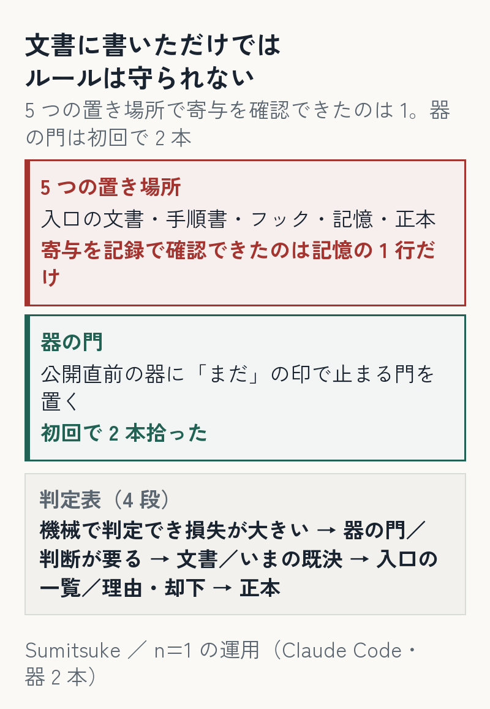

AI（Claude Code）に守らせたい規律を、同じ内容で **5 つの置き場所**に書きました。入口の文書・手順書・フック・記憶・正本。判断への寄与を記録で確認できたのは **1 つ**（記憶）だけでした。逆に、規律を「読む文書」でなく「**実行を止められるスクリプト**」に置いたら、置いた日に 2 本の欠陥を拾いました。

n=1 の運用の記録です。「文書を書くな」でも「全部を機械にしろ」でもなく、**置き場所を分ける判定表**に落とします。



**この記事の位置づけ**（2026-09-26 追記）

- この記事で新しく示すこと: 同じ規律を 5 つの置き場所に書いて、判断への寄与を記録で確認できたのは記憶の 1 行だけだったこと。置き場所の判定表。
- 当てはまる範囲: n=1 の運用（Claude Code）で、ほかの環境では確かめていません。
- 言葉: 本文の「門」＝公開や commit の前に、条件を満たさないと進めないよう自動で止めるチェックのことです。

## 5 つの置き場所で効いたのは 1 つ

規律は「作業の前に正本を引け」。置いた場所と、実際に起きたこと。

| 置き場所 | 書いてあったこと | 起きたこと |
|---|---|---|
| 入口の文書（毎回読み込まれる） | 「正本を引いてから始める」 | 読まれたが、引くスクリプトの名前だけを指していた |
| 手順書 | 同じ | 開かれなかった |
| フック（作業の開始時に自動で本文へ出る） | 「正本を引いてから始めてください」＋スクリプトの名前 | **効いたように見えた**＝「引きました」と報告された |
| 記憶（毎ターン参照される要約） | 同じ規律の 1 行 | **判断を変えた記録があるのはこれだけ** |
| 正本 | 規律の本文 | 一度も開かれなかった |

からくりはこうです。フックが指していたスクリプト（`--which`）は、**文書の所在を 4 行返すだけで本文を出さない**。本文は別の口（`--section`）で引く。AI は所在の 4 行を見て「正本を引きました」と報告し、規律の本文には一度も触れていなかった。5 つの置き場所のうち、判断を変えた記録が残っているのは記憶の 1 行だけ（5 つは併存していたので、他の 4 つの寄与が 0 だったと言い切ることはできない）。

文書は「読まれたら効く」もので、読まれない・読み飛ばされる・古い指示を先に読む・**スクリプトの出力を読んだつもりになる**、のどれかで消えます。

## 公開直前のチェックに置いたら初回で 2 本拾った

別の規律「公開する表に『まだ』（未裁定）の行を残したまま記事を公開しない」を、文書だけでなく**公開直前に毎回通るスクリプトのチェック**に置きました。本文に `裁定待ち` や `TBD` があれば止まり、「未裁定」の語があれば行を印字する、それだけの門です。

置いた日に、待ち行列の記事 2 本が「11 本未裁定」のまま＝その日の裁定（2 本を裁定済み）と食い違っているのを、印字で拾いました。文書に書いた規律は 5 つの置き場所で寄与を確認できたのが 1 つ、公開直前のスクリプトのチェックに置いた規律は初回で 2 本拾った。（逆側の数字として、人 0 実験の副評価に「公開直前に効いた運用ゲート 4 つを止めたのは人 4/4・AI 0/4」があります。別の記事で公開する予定で、この記事ではその根拠は示しません。）

## 置き場所の判定表

「全部をスクリプトのチェックにする」方向へは行きません。スクリプトは保守費を食い、当方は機械検査を 2 本に絞る決めをしています（検査器を直した回数 22 が、検査器が捕まえた欠陥 5 を上回った）。置き場所は 4 段。

| 規律の性質 | 置き場所 | なぜ |
|---|---|---|
| **機械で真偽を判定でき、破ると損失が大きい** | **スクリプトの門**（通らないと進めない・印字は門にする） | 読まれる前提が要らない |
| 判断が要る（機械で判定できない） | 文書（手順書・正本） | 読まれたら効く。古くなる |
| いま効いている既決（1 件 1 行） | 入口の一覧 | 毎回目に入る（読み飛ばせる） |
| 詳しい理由・却下・数値 | 正本 | 引かれたときだけ |

規律を 1 つ足すとき、**先に「スクリプトの門に置けるか」を問う**。置けるのは 1 段目だけ。置けないものを 2〜4 段目に書く。逆に、2〜4 段目に置いた規律が 2 回以上破られたら、1 段目に降ろせないかを見る（今回の「まだ」の門はそれ）。

## チェックの中核（抜粋・自己完結）

```python
import re

def gate(slug: str, body: str) -> None:
    """公開直前の処理の中で呼ぶ。止める語は止め、数える語は行を印字する。コードの中（```…``` と `…`）は見ない"""
    prose = re.sub(r"```.*?```", "", body, flags=re.S)
    prose = re.sub(r"`[^`\n]*`", "", prose)
    for bad in (r"裁定待ち", r"TO-MEASURE", r"\bTBD\b"):
        assert not re.search(bad, prose), f"{slug}: 本文に「まだ」の印 {bad}＝閉じてから積む"
    for m in re.finditer(r"^.*(not_adjudicated|未裁定).*$", prose, re.M):
        print(f"  ⚠ {slug}: 未裁定の語がある行（本文が「まだ N 行」と同じ数を言っているか読む）: {m.group(0)[:100]}")
```

わざと壊した入力 5 件（`裁定待ち` → 止まる／`TBD` → 止まる／`TBDX` → 通る／コードスパンの中の `TBD` → 通る／`未裁定` → 印字）で確かめてから使っています。

印字は「見れば分かる」の約束にしない。**印字が門**＝出たら読む、がスクリプトの側の前提。⚠ この門を書いたとき、`\b` が backspace 文字になって正規表現が死んでいました（[別記事](https://sumitsuke.jp/via/zenn/lab/file-edit-five-traps-windows/)）。このチェックは、コードの中（```…``` と `…`）は見ない処理にしています。門を作った瞬間に、わざと壊した入力で門を試す、までが 1 セットです。

## 言わないこと

- 「文書を書くな」とは言わない。判断が要る規律は文書にしか置けない。
- 「全部をスクリプトにしろ」とも言わない。スクリプトは保守費を食う。置けるのは機械で判定できるものだけ。
- n=1 運用者・スクリプト 2 本の記録で、一般法則ではない。5 つは異質（文書・フック・記憶・正本）なので「5 か所の文書」とは呼ばない。

この記事の本家（5 つの置き場所の表・門をわざと壊した入力で試した結果・検証の記録）は Sumitsuke Lab → [規律の置き場所——同じ規律を 5 つの置き場所に書いて効いたのは記憶の 1 行、公開直前のスクリプトに置いたチェックは初回で 2 本拾った](https://sumitsuke.jp/via/zenn/lab/rule-placement-document-vs-gate/)。

### AI の利用について

規律を破ったのも門を書いたのも AI（Claude Code）で、置き場所の裁定・門をわざと壊した入力で試すテスト・公開の判断は人が行いました。

### 関連

この記事は、規律をどこに置くかの話（当方は、条件を満たさないと進めないよう止めるチェックを「門」と呼んでいます）でした。前は、結論を書く前に探した範囲を確かめる話 → [否定の結論には探した範囲を残す——AI の「できない」4 回を取り消し、否定 40 行に範囲つきは 0 行](https://sumitsuke.jp/via/zenn/lab/negation-needs-search-scope/)。次は、いま効いている既決だけを入口に置く話 → [いま効いている既決だけを入口に置く——字句検索 50 位・予告語彙 9%・全量注入 52 倍の後に「探さない、置く」](https://sumitsuke.jp/via/zenn/lab/active-decision-register/)。

次に読む: [自作の検査器を数か月運用して数えたら、捕まえた欠陥 5 件に対して検査器を直した回数が 22 件だった](https://sumitsuke.jp/via/zenn/lab/green-is-not-proof/)
