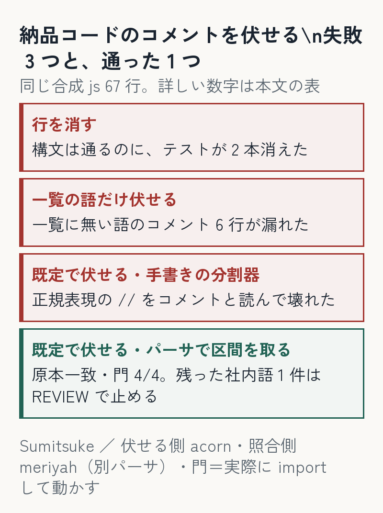
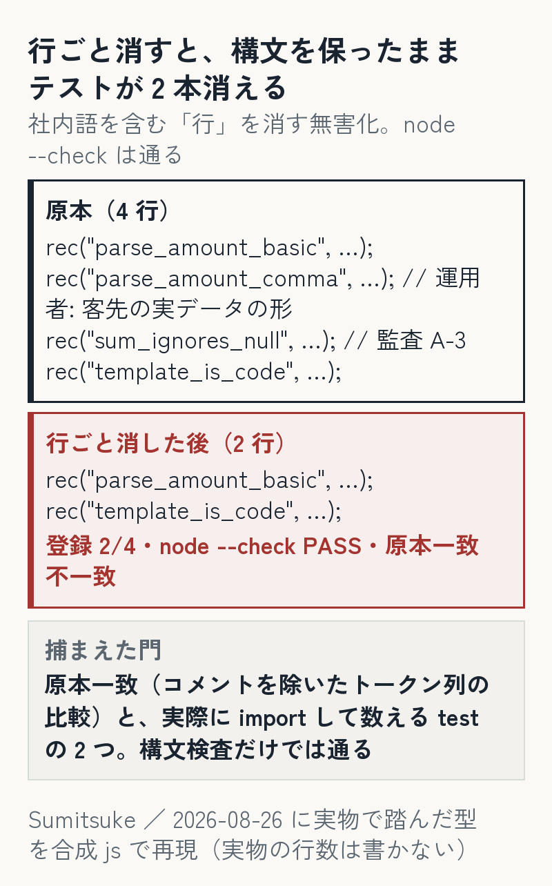
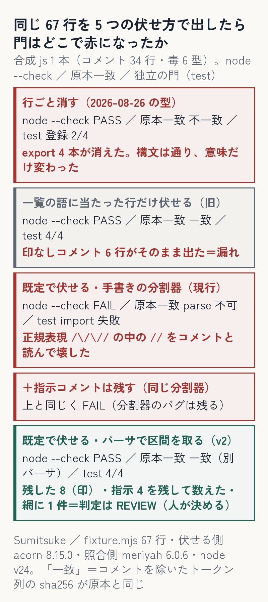

2026-08-26、納品の直前に「社内の注記が入った行」をスクリプトで消して、`node --check` が通ったので渡そうとした。そのコードは、テストが 4 本のうち 2 本しか登録されない状態になっていた。構文は正しい。動きもする。ただ、行末に「運用者:」「監査 A-3」と書いた登録行が、コメントごと丸ごと消えていただけだった。

この記事は、そこから無害化の方式を 4 回変えて、そのたびに「次は何が壊れたか」をチェックで捕まえた話です。最後に残ったのは、方式ではなく**チェックの組み方**でした。

**この記事の位置づけ**（2026-09-26 追記）

- この記事で新しく示すこと: 注記の行を消す無害化が構文を保ったままテストの登録を 4 本から 2 本にした実例と、既定で伏せる方式に替えたら分割器のバグが出た経緯。
- 当てはまる範囲: 合成の js 67 行・当方の納品物の型です。
- 言葉: 本文の「門」＝公開や commit の前に自動で止めるチェック、「器」＝点検や処理のための自作スクリプト、「毒」＝チェックが効くか確かめるためにわざと壊した入力のことです。

## 1 回目: 行を消したら、テストが 2 本消えた

最初の無害化は「社内語（監査・運用者・案件…）を含む行を消す」でした。合成 js 67 行（コメント 34 行）で同じことをすると、23 行が消えて 44 行になり、`export` が 4 本欠け、テスト登録は 2/4。`node --check` は緑です。

つまり構文検査は、この型の壊れ方を**原理的に見ない**。行末コメントつきの宣言行は、コメントを消すのではなく行ごと消えるので、構文は保たれたまま意味だけが変わります。

捕まえたのは 2 つの別の門でした。

- **原本一致**: 伏せた後のコードから、コメントを除いたトークン列を取り、原本のそれと sha256 で比べる。行を消すと当然ずれる。
- **独立の門**: 伏せた後のモジュールを本当に `import` して、登録されたテスト数と関数の返り値を数える。2/4 が出る。

## 2 回目: 「一覧の語に当たった行だけ伏せる」は向きが逆だった

次に「行は消さず、一覧の 20 語に当たったコメントだけ伏せ字にする」に変えました。原本一致は通り、門も 4/4。ところがコメント 34 行のうち、一覧に無い語で書かれた内部の注記 **6 行がそのまま出た**。一覧を増やせば減りますが、一覧に無い語は永遠に通る＝**fail-open** です。

向きを変える必要がありました。**既定で全部伏せ、残したいコメントにだけ印（`客先向け:`）を付ける**。これなら「印を付け忘れた行が漏れる」ことは構成上起きない。漏れ 0 は測って得た成果ではなく、方式を選んだ時点で決まります。

## 3 回目: 既定で伏せたら、分割器が壊れた

ここで壊れたのは、伏せる規則ではなく**コメントとコードを切り分ける手書きの分割器**でした。合成 js に仕込んだ毒のうち、正規表現リテラル `/\/\//` の中の `//` を行コメントの開始と読み、出力が parse できない。`node --check` FAIL、原本一致は parse 不可、門は import 失敗。

一覧方式のときは「当たる語が無い行は触らない」ので、この行はたまたま無傷でした。既定で伏せる方式にした瞬間、分割器の穴が全行で踏まれるようになった。**「ツール指示コメント（`webpackIgnore` など）は残す」を同じ分割器に足しても、当然直りません。** 分割器のバグは規則の外にあります。

## 4 回目: パーサで区間を取り、別のパーサで照合する

v2 は、コメントの区間を **acorn** の `onComment` で取り、行ごとに印を見て伏せます（複数行コメントも 1 行ずつ・shebang は残す・行数は変えない）。照合は **meriyah** という別のパーサで行い、コメントを除いたトークン列の sha256 と `export`／関数名の集合を原本と比べます。同じ分割器を両側に使うと、同じバグを共有して「一致」してしまうので、ここは別実装であることが要件です。

結果は原本一致・export 一致・門 4/4。ただし `// @ts-ignore 監査: 型は後で直す` のように、ツール指示として残した行に社内語が入っているものが **1 件**残った。器はこれを消さず、判定を **REVIEW**（終了コード 3）にして止めます。**構造が PASS でも、コメント側の網に 1 件でも残れば人が「残す」と裁定するまで納品しない。**

## 5 方式 × 3 つのチェックを 1 枚に

| 方式 | 行 in→out | 伏せた | 残した(印) | 残した(印なし) | 消した行 | node --check | 原本一致 | export 集合 | 網 cmt/code | 独立の門 |
|---|---|---|---|---|---|---|---|---|---|---|
| ①行ごと消す | 67→44 | 0 | 0 | 0 | 23 | PASS | 不一致 | **4 本欠け** | 0/3 | **FAIL 登録 2/4** |
| ②一覧の語だけ | 67→67 | 13 | 4 | **6** | 0 | PASS | 一致 | 一致 | 6/4 | PASS 4/4 |
| ③既定・手書き分割器 | 67→67 | 19 | 4 | 0 | 0 | **FAIL** | parse 不可 | — | 6/4 | FAIL import |
| ④③＋指示は残す | 67→67 | 15 | 4 | 0 | 0 | **FAIL** | parse 不可 | — | 7/4 | FAIL import |
| ⑤既定・パーサ（v2） | 67→67 | 19 | 8 | 0 | 0 | PASS | **一致** | 一致 | **1**/2 | PASS 4/4 → **REVIEW** |

読み方を 3 つだけ。①は構文が通るのに門 2 つで赤。②は門が全部緑なのに 6 行漏れている（門は「漏れ」を見ない＝方式で塞ぐ）。⑤は全部緑で、それでも REVIEW で止まる。

照合側の門が恒真でないことも見ました。v2 の出力を 1 文字だけ変えた写しを照合に掛けると `token_match: false`、門は `sum_ignores_null` が返り値 −300 で FAIL。

## わざと壊した入力 6 型は先に決めておく

合成 js に仕込んだのは、(i) 文字列中の `https://` (ii) 正規表現 `/\/\//` (iii) テンプレートリテラル中の `/* */` (iv) 行コメント中の `*/` (v) `import(/* webpackIgnore: true */ "x")`（伏せると build の挙動が変わる） (vi) 複数行コメントの先頭行に印・2 行目に内部語、の 6 型です。

(vi) は公開前の外部精査で足したもので、v2 の最初の版は「先頭行に印があれば後続行まで丸ごと残す」逆向きの漏れを持っていました。もう 1 つ、一覧に「社内」を足したら伏せ字「（社内の注記のため省略）」が残存 20 件として数えられた＝**伏せ字が自分の網に当たる**。伏せ字を「（注記を省略）」に変えました。行数も 1 行多く数えていた（末尾改行の後の空要素）。どれも器の出力を読んで気づいたもので、目視では出ませんでした。

## 納品前に 5 分で回す検収表

| # | 見るもの | 合格 |
|---|---|---|
| 1 | 行数 | 原本と同じ（行位置を保つこの方式の要件） |
| 2 | コードの区間 | 別パーサでコメントを除いたトークン列の sha256 が原本と一致 |
| 3 | `export`／関数名の集合 | 原本と一致 |
| 4 | 最後の網（コメント側） | 0 件＝PASS／1 件以上＝REVIEW（人が「残す」と裁定した分だけ通す） |
| 5 | 伏せた行 N／残した行（印つき）M | 件数で書く |
| 6 | ツール指示コメント K 件 | 伏せていない・K 件を人が見た |
| 7 | 独立の門 | 伏せた後のモジュールを実際に動かして緑 |

1 コマンドにまとめてあります: `sanitize_and_check.mjs in.mjs out/ --test test.mjs`＝伏せる→原本一致→門→`report.json`。終了コードは PASS 0／REVIEW 3／FAIL 1。器・合成 js・毒・照合側は https://github.com/sumitsuke/sanitize-comments-fail-closed （MIT／CC BY 4.0・`npm ci` で同じ版）。

## この記事で言えないこと

決定的処理なので同じ入力からは同じ出力が出ます（反復 1 ですが、探索的な 1 回ではなく再現です）。言えるのは合成 js 67 行・5 方式・3 門の範囲まで。bundler を通した後の挙動、識別子や文字列リテラルに入った社内語の漏れは測っていません。「漏れ 0」は既定で伏せる方式を選んだ帰結であって、この器の成績ではありません。

### AI の利用について

器と本文の下書きは AI（Claude Code）が書き、合成 js も AI 製です。毒 5 型は設計で先に固定し、6 型目は外部精査の指摘で足しました。表の数字は器が出した results.csv の写しで、案件のコード・数字は一切使っていません。

### 関連

- 本家（検収表・器・凍結証拠・検証の記録）: https://sumitsuke.jp/via/zenn/lab/sanitize-comments-fail-closed-original-match/
- 自作の検査器が緑でも欠陥は通る: https://sumitsuke.jp/via/zenn/lab/green-is-not-proof/
- 期待値を別の言語で数えたら自分の癖が捕まった（自己比較を避ける）: https://sumitsuke.jp/via/zenn/lab/oracle-independence-caught-my-habits/

---

Sumitsuke は、AI や外注で作ったものの点検と修理、業務自動化、検証を受託しています。「渡す前に壊れていないか」を数で検収する設計は → https://sumitsuke.jp/works/verification/
