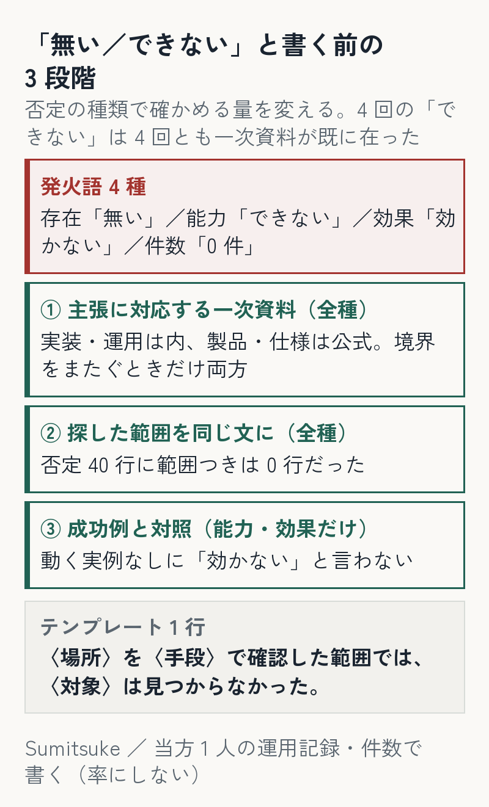

AI（Claude Code）に作業を任せていて、同じ日に「それはできません」を **4 回**書かれ、**4 回とも取り消し**になりました。4 回とも、一次資料は既に手元にありました。別の日には、納品物のコード注記 908 行を数えたら、「無い」と主張する行が **40 行**、そのうち探した範囲を書いている行が **0 行**でした。

この 2 つから当方が変えたのは 1 つだけ。**否定を書くときは、探した範囲を同じ文に残す。** そのための「書く前の 3 段階」（否定の種類で確かめる量を変える）と、否定文のテンプレート 1 行を書きます。

**この記事の位置づけ**（2026-09-26 追記）

- この記事で新しく示すこと: AI の「無い／できない」が 1 日に 4 回とも取り消しになり、否定の 40 行に探した範囲が 0 行だった数と、書く前の 3 段階。
- 当てはまる範囲: 当方 1 人の運用記録です。

## 何が起きたか

### 4 回の「できない」

| 回 | 取り消しの根拠になった一次資料 | 内／外 |
|---|---|---|
| 1 | そのスクリプトの**冒頭の説明文**（機能が書いてあった） | 内 |
| 2 | **手順書**（手順が書いてあった） | 内 |
| 3 | **PowerShell の現物**（コマンドが存在した） | 内 |
| 4 | **公式文書**（口が書いてあった） | 外 |

内 3・外 1。どれも 1〜2 コマンドか 1 ページで確かめられるものでした。「できない」と書く前に、その 1 コマンドを打っていなかった（AI が書いた否定の文そのものは記録に残していないので、ここには載せません）。

### 40 行の「無い」

納品物のコード注記 908 行を、「存在の否定を主張している行」で数えたら 40 行。そのうち「どこを、何で見て、無かったのか」を併記している行は **0 行**。

これが示すのは「40 件の否定が間違っていた」では**ありません**。「40 件とも、探した範囲が残っていなかった」です。書式の欠陥であって誤り率ではない。ただし、その 40 行のうち複数が後続の判断の土台になっていました（「仕様に記載が無いので仮置き」「途中を補う手が無い」→ 機能を 1 つ切った）。範囲が残っていないと、次に読む人はどこまで確認済みか分からず、再探索が要るか、そのまま前提として流用されるかのどちらかになる。

別の日には、当方も同じ型を 1 日に 3 件踏みました。記号つきの語で grep して 0 件と言った（`tp @s` で引いて `@p` を取りこぼす）／現行のフォルダだけ見て「記録が無い」と言った（退避に残っていた）／スクリプトの説明文だけ読んで「こうなっているはず」と言った（実装は違った）。

## 書く前の 3 段階

否定の語（無い／できない／効かない／0 件）を書こうとした瞬間に当てる。3 つ全部を毎回やるのではなく、**否定の種類で確かめる量を変える**。

1. **主張に対応する一次資料を引く。** 自分の実装・運用の話なら内（スクリプトの説明・記録・現物）、製品の能力・仕様の話なら外（公式文書）。**境界をまたぐ主張だけ両方**。4 回の取り消しは内 3・外 1 で、どれも主張に対応する側を引いていなかった。
2. **探した範囲を同じ文に書く（全種）。** 「無い」ではなく「〈場所〉を〈手段〉で確認した範囲では見つからなかった」。範囲が書けないなら、まだ探していない。「コメント 0 件」のような件数の否定はここまでで足りる。
3. **能力・効果を否定するときだけ、成功している現物を 1 つ開く。** 「できない」「効かない」「取り込まれない」は、動いている実例との対照が要る。1 か所を見た不在から構造の結論を出さない。存在・件数の否定にこれは要らない。

## 否定文テンプレート（1 行）

> 〈場所〉を〈手段〉で確認した範囲では、〈対象〉は見つからなかった。

否定は 4 種あるので、発火語も 4 種で持つ。

| 種 | 発火語 | 要る段階 | 範囲つきの例 |
|---|---|---|---|
| 存在 | 無い・見つからない | ①② | `src/` を `grep -rn "like"` で見た範囲では、その関数は無い |
| 能力 | できない・扱えない | ①②③ | このツールの `--help` と手順書 §3 を読んだ範囲では、その操作はできない（成功例: 別のスクリプトで同じ操作が通っている） |
| 効果 | 効かない・取り込まれない | ①②③ | 起動中に開いた 1 回では取り込まれなかった（閉じてから開く経路は未確認） |
| 件数 | 0 件 | ① ② | 09-17T11:20Z 以降・他者のコメントを API で数えた範囲では 0 件 |

「規律を場面（フォルダを触るとき、など）に紐付けると、別の場面で発火しない」——当方はこれで同じ日に 3 件踏みました。だから**出力の語**に紐付ける。

## 最近の 1 例

別の記事で、D1 の「1 文の UPSERT は原子的か」を書くとき、公式 2 頁（SQLite のトランザクション・D1 の API）を取得して、記事には「**単一の `prepare().first()` の原子性を明示した文は、当方が読んだ範囲の公式には無かった**」と範囲つきで書き、原子性を仕様として断言しませんでした。「公式に無い」と書いていたら、次に読む人は探さない。

⚠ この段落は最初、別の例（無料枠の日付）を「範囲つきで書いた」と書いていました。現物を確かめたら、その記事は上限の強制開始日は書かず、数字と「2026-09-18 時点」だけを載せていて、範囲つきの否定は原子性の方でした。否定の書き方を説く記事で、当方が事実と違う記述をしていた例として残します。

## 言わないこと

- 「AI は否定できない」「AI の否定の N% は誤り」とは言わない。4 回・40 行・3 件は当方 1 人の記録で、率ではなく件数。4 回（AI）と 3 件（当方）は別の日。
- 「否定は伝播が速い」「肯定は追認される」は測っていないので言わない。言えるのは、範囲の無い否定が判断の土台になった例が当方にあった、まで。
- 案件の内容には触れない（908 行・40 行という数だけ）。

この記事の本家（4 回の表・40 行の数え方・検証の記録）は Sumitsuke Lab → [否定の結論には探した範囲を残す——AI の「できない」4 回を取り消し、否定 40 行に範囲つきは 0 行](https://sumitsuke.jp/via/zenn/lab/negation-needs-search-scope/)。

### AI の利用について

否定を書いたのも数えたのも AI（Claude Code）で、取り消しの判断・数え方の設計・公開の判断は人が行いました。案件由来の数字は件数だけです。

### 関連

この記事は、結論を書く前に探した範囲を確かめるチェック（当方は「門」と呼んでいます）の話でした。前は、ファイルを書き換える前後を見るチェックの話 → [Windows で AI にファイルを書き換えさせたら触っていない行が変わった——5 つの型を 5 行のファイルで再現した](https://sumitsuke.jp/via/zenn/lab/file-edit-five-traps-windows/)。次は、規律を文書に書くだけでなく発火する場所に置く話 → [規律の置き場所——同じ規律を 5 つの置き場所に書いて効いたのは記憶の 1 行、公開直前のスクリプトに置いたチェックは初回で 2 本拾った](https://sumitsuke.jp/via/zenn/lab/rule-placement-document-vs-gate/)。

次に読む: [AI レビューを現物で照合する運用——3 回・17 件が全部正しくても、指摘されなかった穴が 2 件あった](https://sumitsuke.jp/via/zenn/lab/ai-review-reconciliation/)
