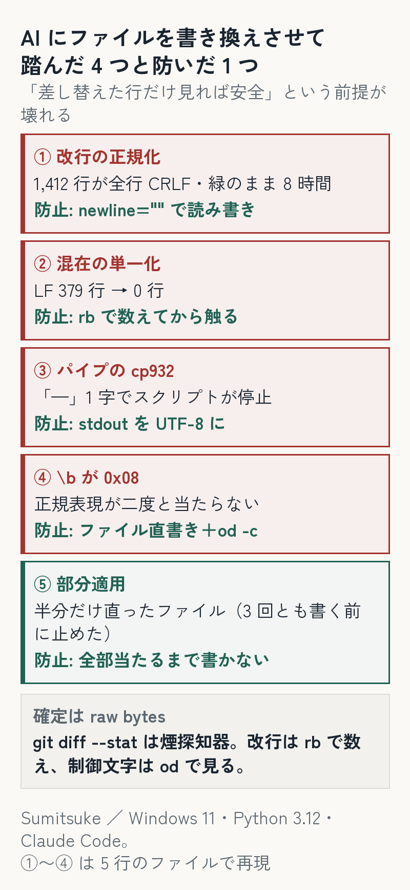

Windows で AI（Claude Code）にファイルを直させていて、同じ型の事故を 4 つ踏み、もう 1 つ（⑤）は踏まずに済みました。5 つはどれも**「差し替え対象の行だけ見れば安全」という前提を壊す**型で（全行が変わる・別の場所が変わる・スクリプトが止まる・半分だけ直る）、Windows 固有の話ではなく、Windows で実際に遭った「テキスト I/O と経路の既定値」の事故です。踏んだ ①〜④ は小さいファイルで再現してから書いています。⑤ は踏まなかった例なので、再現ではなく、防いだ形と 3 回止まった記録です。



| # | 症状 | 隠れて変わったもの | 検出 | 防止 |
|---|---|---|---|---|
| ① | 1 か所足したら**全行が CRLF** に | 改行（LF → CRLF・1,412 行） | `rb` で改行を数える | `newline=""` で読み書き |
| ② | 混在改行のファイルに 1 行の編集 → LF が **0** に | 改行（LF 379 行 → 0） | 同上・混在なら手を止める | 混在を先に解消するか `rb`/`wb` で自分で書く |
| ③ | 印字の途中でスクリプトが止まる | 何も変わらない代わりに**止まる**（cp932） | `sys.stdout.encoding` | `PYTHONIOENCODING=utf-8` か `reconfigure` |
| ④ | 正規表現が二度と当たらない | `\b` が **backspace（0x08）** に | `od -c`・制御文字の grep | コードはファイルに直接書く・書いた後にバイトを見る |
| ⑤ | 途中まで書いてから失敗する（部分適用） | 半分だけ直ったファイル | assert の赤（3 回とも書く前に止まった） | **全部のアンカーが当たるまで 1 バイトも書かない** |

**この記事の位置づけ**（2026-09-26 追記）

- 既に知られていること: Python の既定の文字コードは環境に従い UTF-8 モードで変えられること（[Python の公式文書](https://docs.python.org/3/library/os.html#utf8-mode)）、改行の変換は git の設定と属性で決まること（[git の文書](https://git-scm.com/docs/gitattributes)）。
- この記事で新しく示すこと: AI にファイルを書き換えさせたとき「直した行だけ見れば安全」が崩れる 4 つ（①〜④）を、小さいファイルで再現した結果と、踏まずに済んだ 1 つ（⑤）の形。
- 当てはまる範囲: Windows 11・Python 3.12.10・当方の環境です。

## ① テキスト I/O の改行正規化

Python の既定（`newline=None`）でファイルを読むと、改行は `\n` に正規化され、書くと実行環境の改行（Windows は `\r\n`）に変換されます（[公式](https://docs.python.org/ja/3/library/functions.html#open)）。つまり「読んで、1 か所直して、書き戻す」だけで、**触っていない行も全部 CRLF になる**。

実害: 納品物の JS 1,412 行にアンカー付きで数行足したところ、全 1,412 行が LF → CRLF。`node --check` は通り（CRLF は正しい JS）、E2E 92 断言も自作の検査 22 件も緑のまま、**8 時間**気づかれませんでした。いちばん怖いのは、ほとんど壊れなかったこと。

再現（5 行のファイル）:

```python
open("lf.txt", "wb").write(b"a\nb\nc\nd\ne\n")
s = open("lf.txt", encoding="utf-8").read()                      # 既定＝改行を \n に正規化
open("out.txt", "w", encoding="utf-8").write(s)                  # 既定＝\n を os.linesep に
# → CRLF 5・LF 0（全行が変わる）。newline="" で読み書きすると CRLF 0・LF 5（保たれる）
```

Unix でも CRLF のファイルを全文読み書きすれば逆向きに同じことが起きます。Windows 固有ではなく「既定のテキスト I/O」の仕様です。

## ② 混在改行は「単一化」される

改行が混在したファイル（CRLF 約 1.4 万行＋LF 379 行の記録ファイル）に、編集ツールで **1 行**差し替えたら、LF の 379 行が 0 になりました。純 LF のファイルは同じ編集で LF のまま。

最初は「多数派に揃えている」と思いましたが、Python の `open()` 既定で再現すると違いました。CRLF 4 行＋LF 2 行を既定で読み書きすると **CRLF 6**＝**そろう先は実行環境の改行**です（この経路は多数派判定ではない）。ただし、事故の経路は Python の `open()` ではなく編集ツールです。この事故（CRLF が多いファイル）は CRLF にそろった形で、編集ツールでは別に、LF が多いファイルで LF にそろった観測もあります。編集ツールがそろう先を何で決めているかの規則は特定していません。言えるのは「混在が単一化された」までです。

防ぎ方は同じ: 編集の前に `rb` で CRLF と LF を数え、混在なら既定のテキスト I/O を通さない。

## ③ パイプ経路では stdout が cp932

Python は Windows のコンソールでは UTF-8 で印字しますが、パイプやリダイレクトなど非コンソール経路ではロケール側の文字コード（日本語 Windows では cp932）になり得ます（[公式](https://docs.python.org/3/library/sys.html#sys.stdout)）。AI がツール経由で Python を走らせる経路はまさにパイプ。「—」や絵文字を含む 1 行の印字で `UnicodeEncodeError` が出て、**スクリプトが途中で止まる**。

再現: 同じ経路で `PYTHONIOENCODING` を外して `print('—')` → `'cp932' codec can't encode character '\u2014'`。付けると `utf-8`。

これは Python 3.12.10（Windows 11）での観測です。Python 3.15 からは UTF-8 モードが既定になる（[PEP 686](https://peps.python.org/pep-0686/)）ので、3.15 以降ではこの結果が変わる可能性があります（3.15 では動かしていません）。

これは「Windows の stdout は cp932」ではなく「**この経路では** cp932」です。防ぎ方は環境変数か、スクリプトの冒頭で `sys.stdout.reconfigure(encoding="utf-8", errors="replace")`。

## ④ バックスラッシュが 1 段減って `\b` が backspace になる

正規表現 `\bTBD\b` をスクリプトに足したのに、二度と当たらない。`od -c` で見ると **`\b` が 0x08（backspace）**でした。

経路は「AI のツール → シェルのヒアドキュメント → Python の非 raw 文字列 → ファイルへ書く」。この経路では、**ヒアドキュメントの区切りを引用しても** `\\b` が `\b` になって届き、Python の非 raw 文字列が `\b` を backspace にしていました（再現 2/2＝引用あり・なしとも）。Bash のヒアドキュメント自体の仕様ではありません（引用した区切りなら展開しないのが仕様）。**当方の経路の観測**です。

防ぎ方: 正規表現を含むコードは**ヒアドキュメント越しに流さず、ファイルに直接書く**。書いた直後に `od -c` か、制御文字の grep でバイトを見る。

## ⑤ 途中まで書いてから失敗する（部分適用）

複数箇所を順に差し替えるスクリプトは、3 か所目のアンカーが外れた時点で 2 か所目まで書き込み済み＝**半分だけ直ったファイル**が残ります。これが 5 つ目の罠で（当方は踏まずに済みました）、防ぎ方は「全部のアンカーが 1 回ずつ当たることを確かめてから、1 回だけ書く」。この形にしておいたら、同じ日に 3 回、途中のアンカーが外れて止まり、**3 回ともファイルは無傷**でした（旧版に当てていた・写しと本文が違った・同じ文が 2 か所にあった）。罠を踏まなかった唯一の例なので、防波堤として載せます。

```python
for old, new in pairs:
    assert s.count(old) == 1, old[:40]   # 1 つでも外れたら、ここで止まる。まだ何も書いていない
    s = s.replace(old, new)
open(p, "w", encoding="utf-8", newline="\n").write(s)   # 全部当たってから 1 回だけ書く
```

## 書き換え前の点検（31 行）

上の ①〜④ を、書き換える前に 1 回見る小さなスクリプトを同梱します（依存なし）。改行の内訳（CRLF／LF／孤立 CR／混在）・制御文字・stdout の文字コードを印字し、混在・孤立 CR・制御文字のどれかがあれば exit 1。

```
$ python preflight_edit.py mixed.txt ctrl.txt
stdout: encoding=cp932 isatty=False PYTHONIOENCODING=None  ⚠ UTF-8 でない＝絵文字や「—」の印字で止まる
mixed.txt: 混在 CRLF=4 LF=2 孤立CR=0  ⚠ 混在＝既定のテキスト I/O で読み書きすると全行が実行環境の改行にそろう
ctrl.txt: LF CRLF=0 LF=1 孤立CR=0  ⚠ 制御文字 0x08（\b が backspace になっていないか）
```

スクリプトの中身は本家（Lab）に置いています。⚠ このスクリプトも最初は罠③を自分で踏みました（cp932 の経路で自分の「⚠」が印字できずに落ちた）。冒頭で自分の stdout を UTF-8 に切り替えてから印字する形に直しています。⚠ もう 1 つ、公開前の読者の再現で**孤立 CR（`\r` だけの改行）を「改行なし」と表示したまま exit 0 で通す穴**が見つかりました。既定のテキスト I/O は `\r` も改行として読むので混在と同じ脅威です。v2 で赤にしました（わざと壊した入力 `a\rb\r` で exit 1）。

`git diff --stat` は**煙探知器**です。「1 file changed, 3 insertions」のはずが行数が膨らんでいたら全行が変わっています。ただし Git は `core.autocrlf` や `.gitattributes` で改行を正規化するので、最終保証にはなりません。確定は raw bytes で数える方です。

## 追記（2026-09-26）

- 数える側の罠も 1 つ。改行の CR を数えようと、ダブルクォートの中に `$'\r'` を書いて grep したら「CR が 2,225 個」と出ました（09-25）。`$'\r'` はダブルクォートの中では展開されず、grep が全行に当たっていただけです。`git ls-files --eol` で見ると i/lf（CR は 0）でした。
- 書いた後に数える点検の出力も、別の方法で数え直してから信じます。

## 言わないこと

- 「Windows が悪い」「Bash のヒアドキュメントが壊す」とは言わない。既定値と経路の話。
- 5 つは当方が遭った順で（⑤だけは踏まずに済んだ例）、網羅ではない。
- ④の 1 段減る場所は当方の経路の観測。経路が違えば起きない。

この記事の本家（再現の全出力・復旧手順・検証の記録）は Sumitsuke Lab → [Windows で AI にファイルを書き換えさせたら触っていない行が変わった——5 つの型を 5 行のファイルで再現した](https://sumitsuke.jp/via/zenn/lab/file-edit-five-traps-windows/)。

### AI の利用について

事故を起こしたのも再現したのも AI（Claude Code）で、切り分け・再現の設計・公開の判断は人が行いました。案件由来の数字は行数だけで、ファイル名・内容・日付は書いていません。

### 関連

この記事は、ファイルを書き換える前後を見るチェック（当方は「門」と呼んでいます）の話でした。次は、結論を書く前に探した範囲を確かめるチェックの話 → [否定の結論には探した範囲を残す——AI の「できない」4 回を取り消し、否定 40 行に範囲つきは 0 行](https://sumitsuke.jp/via/zenn/lab/negation-needs-search-scope/)。

次に読む: [自作の検査器を数か月運用して数えたら、捕まえた欠陥 5 件に対して検査器を直した回数が 22 件だった](https://sumitsuke.jp/via/zenn/lab/green-is-not-proof/)
